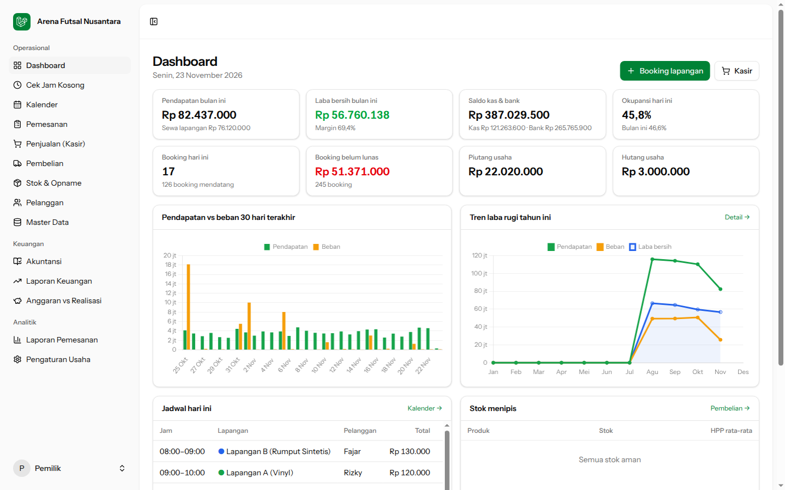

<div align="center">

# Futsal Manager

**A futsal court rental management app, from bookings to financial statements, in one system.**

[](https://github.com/latifismail53/futsal-manager/actions/workflows/tests.yml)


[](LICENSE)

[Bahasa Indonesia](README.md) | English



</div>

## About

Futsal Manager helps futsal court owners run daily operations and bookkeeping from a single web app:

- See **free time slots** for any date and book them in one click.
- Every transaction (booking, deposit, settlement, sale, purchase, stock count) is **journaled automatically**, so the income statement, balance sheet, and cash flow are always up to date.
- Responsive UI for phones, tablets, and desktops, with role-based access (Owner, Admin, Cashier, Accountant).

The UI is in Bahasa Indonesia and amounts are in Rupiah. It also fits other court-rental businesses such as badminton or mini soccer.

## Features

| Module                        | What it does                                                                                                                                          |
| ----------------------------- | ----------------------------------------------------------------------------------------------------------------------------------------------------- |
| Availability (Cek Jam Kosong) | Pick a date and duration (1–4 h), see free slots and prices per court, 14-day availability strip, share via WhatsApp, book directly                   |
| Calendar                      | Day, week, and month views; click an empty slot to book                                                                                               |
| Bookings                      | Day/night rates, deposits and settlements (cash/bank), weekly recurring bookings with conflict detection, receipts, WhatsApp confirmation, CSV export |
| Point of Sale                 | Food & beverage and equipment rental, stock checks, change calculation, receipts                                                                      |
| Purchases                     | Inventory, expenses, and assets; cash, bank, or credit; supplier payables; weighted-average cost                                                      |
| Stock                         | Inventory value, stock cards, low-stock alerts, stock counts with automatic adjustment journals                                                       |
| Customers                     | Booking totals, hours played, spending, outstanding balance, full history, WhatsApp reminders                                                         |
| Accounting                    | Automatic and manual journals (unbalanced entries are rejected), general ledger, trial balance, chart of accounts                                     |
| Financial statements          | Income statement, balance sheet (balance check), direct-method cash flow, financial ratios, monthly charts                                            |
| Budget vs actual              | Monthly budget per account compared with actuals                                                                                                      |
| Booking analytics             | Interactive charts (date, court, weekday, hour, customer, occupancy heatmap); click a chart to filter the detail table                                |

More screenshots are in the [Indonesian README](README.md#tangkapan-layar).

## Tech stack

PHP 8.3+, Laravel 13, Fortify, Inertia.js 3, React 19, TypeScript, Tailwind CSS 4, shadcn/ui, Chart.js, MySQL 8, Redis. Quality checks: PHPUnit, Larastan level 7, Pint, TypeScript, Vite+ lint, GitHub Actions. See [docs/ARCHITECTURE.md](docs/ARCHITECTURE.md).

## Getting started

Requirements: PHP 8.3+ (`pdo_mysql`, `redis` extensions), Composer, Node.js 22+, pnpm, MySQL 8, Redis.

```bash
git clone https://github.com/latifismail53/futsal-manager.git
cd futsal-manager
composer install && pnpm install
cp .env.example .env && php artisan key:generate
# set DB_* and REDIS_* in .env, then create the "futsal" database
php artisan migrate --seed
pnpm run build
php artisan serve
```

Demo accounts (password `password`): `owner@futsal.test`, `admin@futsal.test`, `kasir@futsal.test`, `akuntan@futsal.test`. Remove them and set `FUTSAL_ALLOW_RESET=false` before going to production.

## Testing

```bash
php artisan test
vendor/bin/pint --test
vendor/bin/phpstan analyse
pnpm run check && pnpm run types:check
```

## Built with Devin AI

All of the code in this repository, from the first version and the Laravel migration to this documentation, was written by [Devin](https://devin.ai), the AI software engineer by [Cognition AI](https://cognition.ai), at the request and direction of [@latifismail53](https://github.com/latifismail53). That is why most commits are authored by **devin-ai-integration[bot]**, the GitHub account Devin uses to write code and open pull requests. The repository owner defined the requirements, chose the stack, and reviewed the results.

## License

[MIT](LICENSE)
