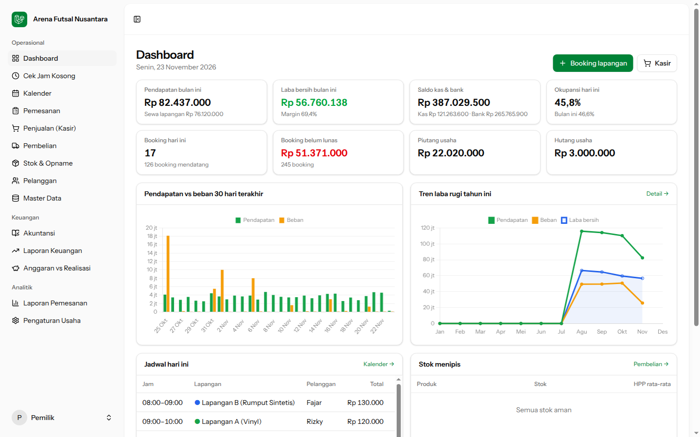
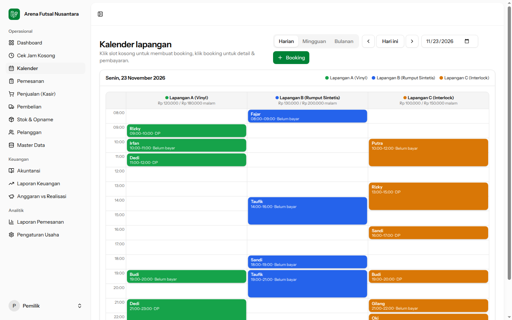
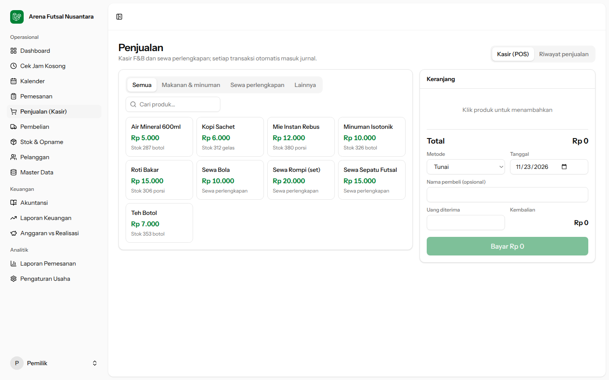
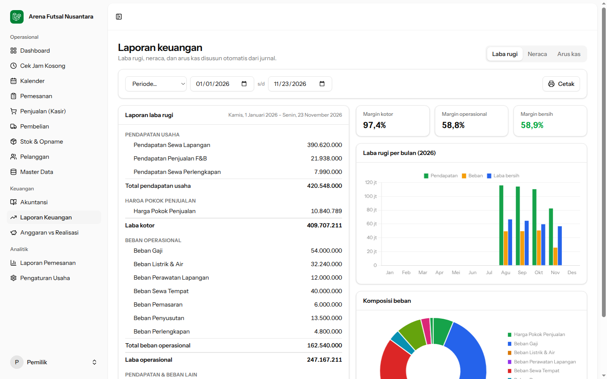
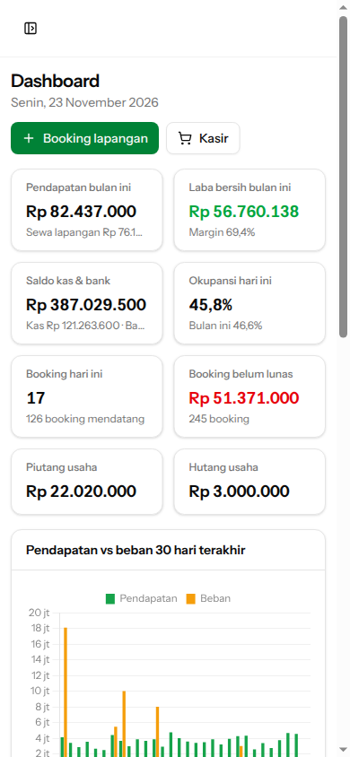

<div align="center">

# Futsal Manager

**Aplikasi manajemen rental lapangan futsal, dari booking sampai laporan keuangan, dalam satu sistem.**

[](https://github.com/latifismail53/futsal-manager/actions/workflows/tests.yml)


[](LICENSE)

Bahasa Indonesia | [English](README.en.md)



</div>

## Tentang

Futsal Manager membantu pemilik dan pengelola lapangan futsal menjalankan operasional harian dan pembukuan dari satu aplikasi web:

- Pelanggan bisa langsung diberi tahu **jam kosong** pada tanggal tertentu, lalu dibookingkan dengan sekali klik.
- Setiap transaksi (booking, DP, pelunasan, penjualan, pembelian, stok opname) **otomatis dijurnal**, sehingga laba rugi, neraca, dan arus kas selalu terbarui tanpa input ganda.
- Tampilan responsif untuk HP, tablet, dan desktop, dengan hak akses per peran (Owner, Admin, Kasir, Akuntan).

Cocok untuk usaha rental futsal (atau olahraga lapangan lain seperti badminton dan mini soccer) yang ingin berhenti memakai buku tulis atau spreadsheet terpisah.

## Fitur

| Modul                 | Isi                                                                                                                                                                         |
| --------------------- | --------------------------------------------------------------------------------------------------------------------------------------------------------------------------- |
| Cek Jam Kosong        | Pilih tanggal dan durasi (1–4 jam), lihat slot kosong per lapangan dan harganya, strip ketersediaan 14 hari, bagikan info ke WhatsApp, booking langsung dari slot           |
| Kalender              | Tampilan harian, mingguan, bulanan; klik slot kosong untuk booking, klik booking untuk mengubah                                                                             |
| Pemesanan             | Tarif siang/malam otomatis, DP dan pelunasan (tunai/bank), booking rutin mingguan dengan deteksi bentrok, status selesai/batal, cetak nota, konfirmasi WhatsApp, ekspor CSV |
| Penjualan (Kasir)     | POS untuk F&B dan sewa perlengkapan, cek stok, uang diterima dan kembalian, cetak nota, riwayat                                                                             |
| Pembelian             | Pembelian stok, beban, dan aset; tunai, bank, atau kredit; pelunasan hutang supplier; HPP rata-rata tertimbang                                                              |
| Stok & Opname         | Nilai persediaan, kartu stok per barang, stok menipis, opname dengan jurnal selisih otomatis                                                                                |
| Pelanggan             | Total booking, jam main, nilai belanja, tagihan, riwayat lengkap, pengingat tagihan via WhatsApp                                                                            |
| Akuntansi             | Jurnal otomatis dan manual (ditolak bila tidak seimbang), buku besar, neraca saldo, bagan akun (COA)                                                                        |
| Laporan Keuangan      | Laba rugi, neraca (dicek seimbang), arus kas metode langsung, rasio keuangan, grafik bulanan                                                                                |
| Anggaran vs Realisasi | Anggaran per akun per bulan, perbandingan dengan realisasi beserta selisih dan persentase                                                                                   |
| Laporan Pemesanan     | Grafik interaktif (tanggal, lapangan, hari, jam, pelanggan, peta okupansi); klik grafik untuk memfilter tabel detail                                                        |
| Master & Pengaturan   | Lapangan, produk, pelanggan, supplier; identitas usaha, jam operasional, rekening, catatan kaki nota                                                                        |

## Tangkapan layar

| Cek Jam Kosong                                     | Kalender                                                     |
| -------------------------------------------------- | ------------------------------------------------------------ |
|  |                    |
| **Kasir (POS)**                                    | **Laporan Keuangan**                                         |
|            |    |
| **Anggaran vs Realisasi**                          | **Laporan Pemesanan Interaktif**                             |
|          |  |

<p align="center">
  
  
</p>

## Teknologi

| Lapisan  | Teknologi                                                                              |
| -------- | -------------------------------------------------------------------------------------- |
| Backend  | PHP 8.3+, Laravel 13, Fortify (login, 2FA)                                             |
| Frontend | Inertia.js 3, React 19, TypeScript, Tailwind CSS 4, shadcn/ui (Radix UI), Chart.js     |
| Data     | MySQL 8, Redis (cache, session, queue)                                                 |
| Build    | Vite+ dengan code splitting per halaman; Chart.js hanya dimuat di halaman bergrafik    |
| Kualitas | PHPUnit, Larastan level 7, Laravel Pint, TypeScript, Vite+ lint/format, GitHub Actions |

Penjelasan arsitektur dan aturan akuntansi ada di [docs/ARCHITECTURE.md](docs/ARCHITECTURE.md).

## Instalasi

Kebutuhan: PHP 8.3+ (ekstensi `pdo_mysql`, `redis`), Composer, Node.js 22+, pnpm, MySQL 8, Redis.

```bash
git clone https://github.com/latifismail53/futsal-manager.git
cd futsal-manager

composer install
pnpm install

cp .env.example .env
php artisan key:generate
# sesuaikan DB_* dan REDIS_* di .env, lalu buat database "futsal"

php artisan migrate --seed   # skema + data contoh ±4 bulan
pnpm run build
php artisan serve            # buka http://localhost:8000
```

Untuk pengembangan dengan hot reload, jalankan `composer run dev`.

### Akun demo

Semua memakai password `password`. Menu otomatis menyesuaikan peran.

| Email                 | Peran   | Akses                                                                                                |
| --------------------- | ------- | ---------------------------------------------------------------------------------------------------- |
| `owner@futsal.test`   | Owner   | Semua menu                                                                                           |
| `admin@futsal.test`   | Admin   | Semua menu operasional, stok, pembelian, master data, pengaturan, laporan pemesanan, hapus transaksi |
| `kasir@futsal.test`   | Kasir   | Dashboard, jam kosong, kalender, pemesanan, penjualan, pelanggan                                     |
| `akuntan@futsal.test` | Akuntan | Pembelian, akuntansi, laporan keuangan, anggaran, laporan pemesanan                                  |

> Ganti atau hapus akun demo sebelum dipakai di produksi, dan set `FUTSAL_ALLOW_RESET=false` agar tombol reset data demo nonaktif.

## Produksi

Sebelum menjalankan perintah di bawah, ubah `.env` terlebih dahulu: `APP_ENV=production`, `APP_DEBUG=false`, `FUTSAL_ALLOW_RESET=false`, `APP_URL` dengan `https://`, dan `SESSION_SECURE_COOKIE=true`. Perintah `php artisan optimize` menyimpan konfigurasi ke cache, jadi perubahan `.env` setelahnya tidak berlaku sampai perintah itu dijalankan ulang.

```bash
composer install --no-dev --optimize-autoloader
pnpm install && pnpm run build
php artisan migrate --force
php artisan db:seed --force   # di produksi hanya membuat daftar akun (COA) & pengaturan, tanpa data/akun demo
php artisan futsal:user pemilik@usaha.com --role=owner --name="Pemilik"   # password ditanya interaktif
php artisan optimize          # cache config, route, view, event
php artisan queue:work redis  # jalankan lewat Supervisor/systemd
```

Aktifkan OPcache dan arahkan web server ke folder `public/`. Akun staf lain dibuat dengan perintah yang sama memakai `--role=admin`, `--role=kasir`, atau `--role=akuntan`.

## Pengujian

Tes memakai database MySQL `futsal_test` (lihat `phpunit.xml`).

```bash
php artisan test               # tes fitur: booking bentrok, booking rutin, jurnal, HPP, stok, neraca, hak akses
vendor/bin/pint --test         # format kode PHP
vendor/bin/phpstan analyse     # analisis tipe (Larastan level 7)
pnpm run check                 # lint & format frontend
pnpm run types:check           # TypeScript
```

## Keamanan

Yang sudah diterapkan:

- Hak akses per peran dicek di server (middleware `role:`), tidak hanya dengan menyembunyikan menu.
- Login dibatasi 5 percobaan per menit, tersedia autentikasi dua faktor (2FA), dan pendaftaran akun publik dinonaktifkan.
- Semua endpoint memakai sesi + token CSRF. Endpoint data dibatasi 300 permintaan per menit per pengguna.
- Semua input divalidasi lewat Form Request dan query memakai parameter binding (aman dari SQL injection).
- Header keamanan: `X-Frame-Options`, `X-Content-Type-Options`, `Referrer-Policy`, `Permissions-Policy`, dan HSTS saat HTTPS.
- Ekspor CSV menetralkan sel yang diawali `=`, `+`, `-`, atau `@` agar tidak dijalankan sebagai rumus oleh Excel.
- Reset data demo hanya untuk pemilik dan otomatis mati di produksi. Data dan akun demo tidak dibuat di produksi.
- Stok dan HPP hanya berubah lewat pembelian, penjualan, atau stok opname, sehingga nilai persediaan selalu sama dengan jurnal.
- Menghapus pembayaran booking hanya bisa dilakukan admin. Harga jual di kasir selalu diambil dari master produk di server, bukan dari browser.
- `composer audit` dan `pnpm audit` bersih saat dokumen ini ditulis, dan Dependabot memantau dependensi setiap minggu.

Temukan celah keamanan? Laporkan secara privat sesuai [SECURITY.md](SECURITY.md).

## Batasan

Hal-hal yang perlu diketahui sebelum memakai aplikasi ini:

| Area          | Batasan                                                                                                                                                                                                      |
| ------------- | ------------------------------------------------------------------------------------------------------------------------------------------------------------------------------------------------------------ |
| Pengguna      | Belum ada halaman kelola pengguna. Akun dibuat lewat `php artisan futsal:user`. Satu akun hanya punya satu peran.                                                                                            |
| Usaha         | Satu usaha dan satu lokasi per instalasi (belum multi-cabang/multi-tenant). Hanya mata uang Rupiah tanpa desimal.                                                                                            |
| Booking       | Satuan waktu per jam penuh. Jam operasional tidak bisa melewati tengah malam (paling lambat tutup 24:00). Belum ada booking online oleh pelanggan.                                                           |
| Pembayaran    | Pembayaran dicatat manual (tunai/transfer). Belum ada integrasi QRIS atau payment gateway.                                                                                                                   |
| WhatsApp      | Memakai link `wa.me`, jadi pesan tidak terkirim otomatis. Staf tetap perlu menekan kirim.                                                                                                                    |
| Akuntansi     | Akuntansi dasar: belum ada pajak (PPN/PPh), penyusutan aset otomatis, rekonsiliasi bank, atau penguncian/tutup buku per periode. Transaksi lama masih bisa diubah atau dihapus oleh admin.                   |
| Audit         | Belum ada log aktivitas (siapa mengubah apa dan kapan).                                                                                                                                                      |
| Kontrol kasir | Kasir bisa memberi diskon booking tanpa persetujuan atasan (harga jual di kasir selalu diambil dari master produk). Dashboard menampilkan ringkasan keuangan ke semua peran.                                 |
| Laporan       | Ekspor berupa CSV dan cetak nota lewat browser. Belum ada ekspor PDF/Excel. Laporan dihitung langsung dari jurnal dan di-cache di Redis; data yang sangat besar bisa membuatnya lebih lambat.                |
| Bahasa        | Antarmuka berbahasa Indonesia, kecuali halaman login, lupa password, dan 2FA bawaan starter kit yang masih berbahasa Inggris.                                                                                |
| Infrastruktur | Wajib MySQL 8 (query memakai fungsi khusus MySQL) dan Redis. Lupa password butuh konfigurasi email (`MAIL_*`); bawaannya hanya ditulis ke log. Zona waktu bawaan `Asia/Jakarta` (ubah lewat `APP_TIMEZONE`). |
| Keamanan      | Belum ada Content Security Policy (CSP). Kode belum diaudit oleh pihak ketiga. Uji otomatis mencakup alur utama, bukan semua kemungkinan.                                                                    |

## Peta jalan

- [ ] Laravel Octane (FrankenPHP) untuk respons lebih cepat
- [ ] Laravel Horizon dan Pulse untuk memantau antrean dan performa
- [ ] Ekspor laporan PDF/Excel lewat antrean
- [ ] Booking online mandiri oleh pelanggan
- [ ] Integrasi pembayaran (QRIS / payment gateway)
- [ ] Halaman kelola pengguna dan log aktivitas (audit trail)
- [ ] Tutup buku per periode dan pajak (PPN)

## Kontribusi

Kontribusi sangat diterima. Baca [CONTRIBUTING.md](CONTRIBUTING.md) sebelum membuat pull request, dan laporkan celah keamanan sesuai [SECURITY.md](SECURITY.md).

## Dibuat dengan Devin AI

Seluruh kode aplikasi ini, mulai dari versi awal, migrasi ke Laravel, sampai dokumentasi ini, ditulis oleh [Devin](https://devin.ai), AI software engineer buatan [Cognition AI](https://cognition.ai), atas permintaan dan arahan [@latifismail53](https://github.com/latifismail53).

Karena itu, hampir semua commit di repo ini tercatat atas nama **devin-ai-integration[bot]**, yaitu akun GitHub yang dipakai Devin untuk menulis kode dan membuat pull request. Pemilik repo menentukan kebutuhan, memilih teknologi, dan meninjau hasilnya.

## Lisensi

Dirilis di bawah [Lisensi MIT](LICENSE).
