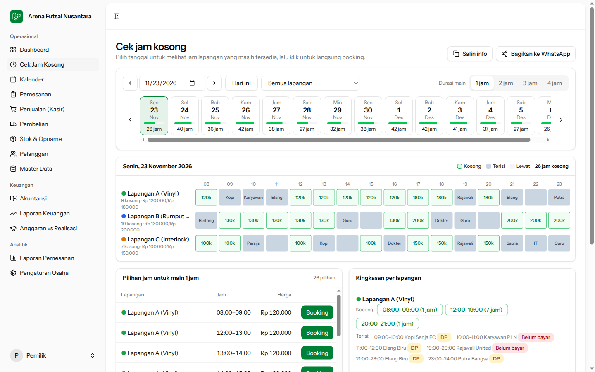
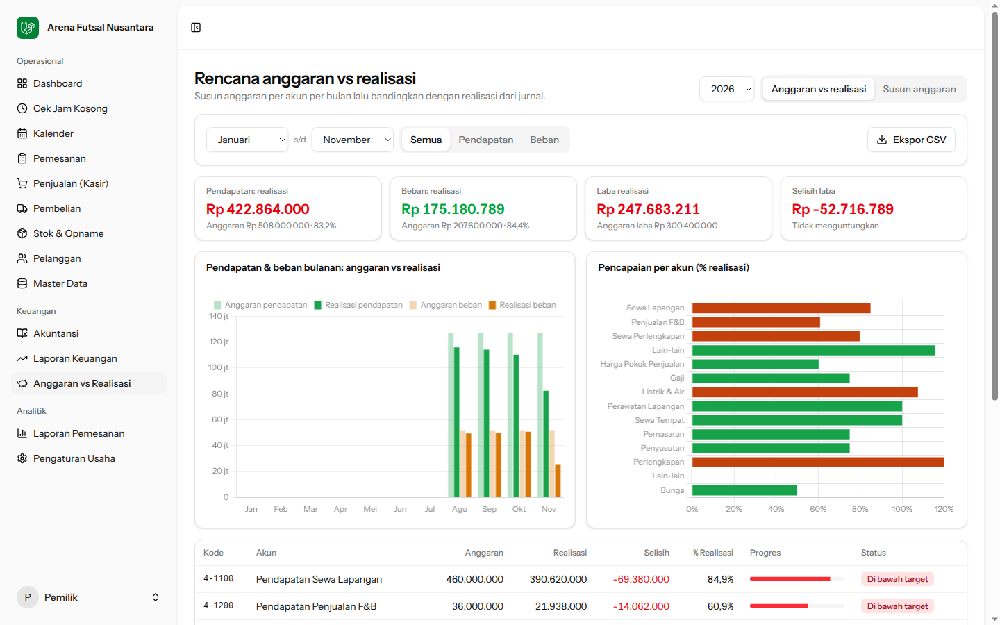
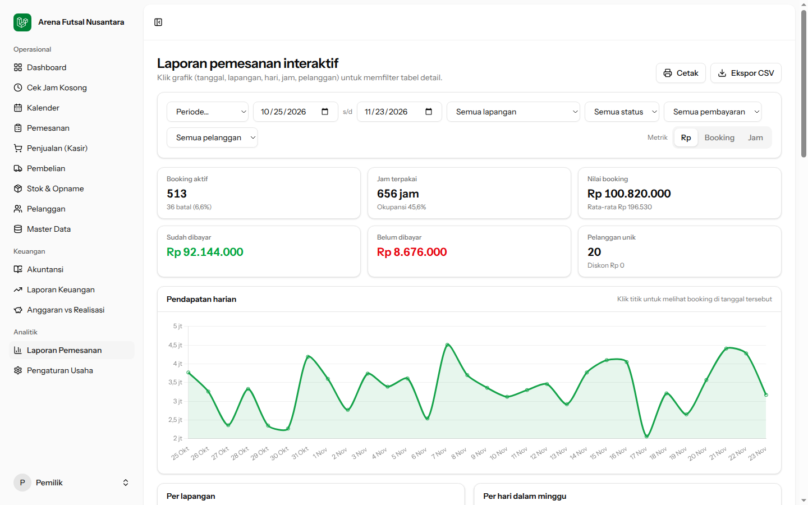
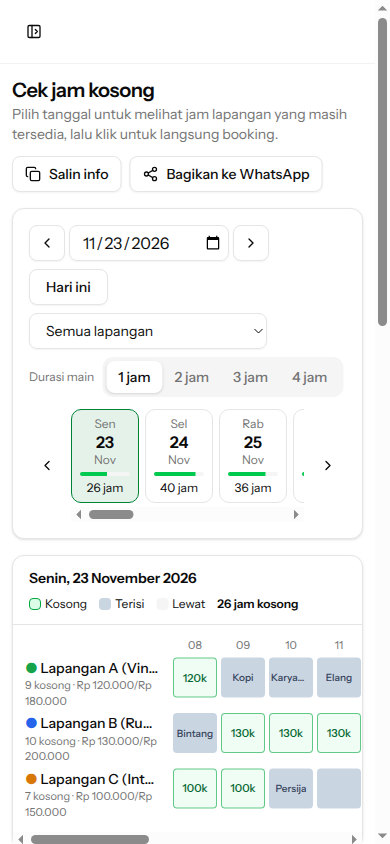

<div align="center">

# Futsal Manager

**Aplikasi manajemen rental lapangan futsal, dari booking sampai laporan keuangan, dalam satu sistem.**

[](https://github.com/latifismail53/futsal-manager/actions/workflows/tests.yml)


[](LICENSE)

Bahasa Indonesia | [English](README.en.md)


</div>

## Tentang

Futsal Manager membantu pemilik dan pengelola lapangan futsal menjalankan operasional harian dan pembukuan dari satu aplikasi web:

- Pelanggan bisa langsung diberi tahu **jam kosong** pada tanggal tertentu, lalu dibookingkan dengan sekali klik.
- Setiap transaksi (booking, DP, pelunasan, penjualan, pembelian, stok opname) **otomatis dijurnal**, sehingga laba rugi, neraca, dan arus kas selalu terbarui tanpa input ganda.
- Tampilan responsif untuk HP, tablet, dan desktop, dengan hak akses per peran (Owner, Admin, Kasir, Akuntan).

Cocok untuk usaha rental futsal (atau olahraga lapangan lain seperti badminton dan mini soccer) yang ingin berhenti memakai buku tulis atau spreadsheet terpisah.

## Fitur

| Modul                 | Isi                                                                                                                                                                         |
| --------------------- | --------------------------------------------------------------------------------------------------------------------------------------------------------------------------- |
| Cek Jam Kosong        | Pilih tanggal dan durasi (1–4 jam), lihat slot kosong per lapangan dan harganya, strip ketersediaan 14 hari, bagikan info ke WhatsApp, booking langsung dari slot           |
| Kalender              | Tampilan harian, mingguan, bulanan; klik slot kosong untuk booking, klik booking untuk mengubah                                                                             |
| Pemesanan             | Tarif siang/malam otomatis, DP dan pelunasan (tunai/bank), booking rutin mingguan dengan deteksi bentrok, status selesai/batal, cetak nota, konfirmasi WhatsApp, ekspor CSV |
| Penjualan (Kasir)     | POS untuk F&B dan sewa perlengkapan, cek stok, uang diterima dan kembalian, cetak nota, riwayat                                                                             |
| Pembelian             | Pembelian stok, beban, dan aset; tunai, bank, atau kredit; pelunasan hutang supplier; HPP rata-rata tertimbang                                                              |
| Stok & Opname         | Nilai persediaan, kartu stok per barang, stok menipis, opname dengan jurnal selisih otomatis                                                                                |
| Pelanggan             | Total booking, jam main, nilai belanja, tagihan, riwayat lengkap, pengingat tagihan via WhatsApp                                                                            |
| Akuntansi             | Jurnal otomatis dan manual (ditolak bila tidak seimbang), buku besar, neraca saldo, bagan akun (COA)                                                                        |
| Laporan Keuangan      | Laba rugi, neraca (dicek seimbang), arus kas metode langsung, rasio keuangan, grafik bulanan                                                                                |
| Anggaran vs Realisasi | Anggaran per akun per bulan, perbandingan dengan realisasi beserta selisih dan persentase                                                                                   |
| Laporan Pemesanan     | Grafik interaktif (tanggal, lapangan, hari, jam, pelanggan, peta okupansi); klik grafik untuk memfilter tabel detail                                                        |
| Master & Pengaturan   | Lapangan, produk, pelanggan, supplier; identitas usaha, jam operasional, rekening, catatan kaki nota                                                                        |

## Tangkapan layar

| Cek Jam Kosong                                     | Kalender                                                     |
| -------------------------------------------------- | ------------------------------------------------------------ |
|  |                    |
| **Kasir (POS)**                                    | **Laporan Keuangan**                                         |
|            |    |
| **Anggaran vs Realisasi**                          | **Laporan Pemesanan Interaktif**                             |
|          |  |

<p align="center">
  
  
</p>

## Teknologi

| Lapisan  | Teknologi                                                                              |
| -------- | -------------------------------------------------------------------------------------- |
| Backend  | PHP 8.3+, Laravel 13, Fortify (login, 2FA)                                             |
| Frontend | Inertia.js 3, React 19, TypeScript, Tailwind CSS 4, shadcn/ui (Radix UI), Chart.js     |
| Data     | MySQL 8, Redis (cache, session, queue)                                                 |
| Build    | Vite+ dengan code splitting per halaman; Chart.js hanya dimuat di halaman bergrafik    |
| Kualitas | PHPUnit, Larastan level 7, Laravel Pint, TypeScript, Vite+ lint/format, GitHub Actions |

Penjelasan arsitektur dan aturan akuntansi ada di [docs/ARCHITECTURE.md](docs/ARCHITECTURE.md).

## Instalasi

Kebutuhan: PHP 8.3+ (ekstensi `pdo_mysql`, `redis`), Composer, Node.js 22+, pnpm, MySQL 8, Redis.

```bash
git clone https://github.com/latifismail53/futsal-manager.git
cd futsal-manager

composer install
pnpm install

cp .env.example .env
php artisan key:generate
# sesuaikan DB_* dan REDIS_* di .env, lalu buat database "futsal"

php artisan migrate --seed   # skema + data contoh ±4 bulan
pnpm run build
php artisan serve            # buka http://localhost:8000
```

Untuk pengembangan dengan hot reload, jalankan `composer run dev`.

### Akun demo

Semua memakai password `password`. Menu otomatis menyesuaikan peran.

| Email                 | Peran   | Akses                                                                                                |
| --------------------- | ------- | ---------------------------------------------------------------------------------------------------- |
| `owner@futsal.test`   | Owner   | Semua menu                                                                                           |
| `admin@futsal.test`   | Admin   | Semua menu operasional, stok, pembelian, master data, pengaturan, laporan pemesanan, hapus transaksi |
| `kasir@futsal.test`   | Kasir   | Dashboard, jam kosong, kalender, pemesanan, penjualan, pelanggan                                     |
| `akuntan@futsal.test` | Akuntan | Pembelian, akuntansi, laporan keuangan, anggaran, laporan pemesanan                                  |

> Ganti atau hapus akun demo sebelum dipakai di produksi, dan set `FUTSAL_ALLOW_RESET=false` agar tombol reset data demo nonaktif.

## Produksi

```bash
composer install --no-dev --optimize-autoloader
pnpm install && pnpm run build
php artisan migrate --force
php artisan optimize          # cache config, route, view, event
php artisan queue:work redis  # jalankan lewat Supervisor/systemd
```

Set `APP_ENV=production` dan `APP_DEBUG=false`, aktifkan OPcache, dan arahkan web server ke folder `public/`.

## Pengujian

Tes memakai database MySQL `futsal_test` (lihat `phpunit.xml`).

```bash
php artisan test               # tes fitur: booking bentrok, booking rutin, jurnal, HPP, stok, neraca, hak akses
vendor/bin/pint --test         # format kode PHP
vendor/bin/phpstan analyse     # analisis tipe (Larastan level 7)
pnpm run check                 # lint & format frontend
pnpm run types:check           # TypeScript
```

## Peta jalan

- [ ] Laravel Octane (FrankenPHP) untuk respons lebih cepat
- [ ] Laravel Horizon dan Pulse untuk memantau antrean dan performa
- [ ] Ekspor laporan PDF/Excel lewat antrean
- [ ] Booking online mandiri oleh pelanggan
- [ ] Integrasi pembayaran (QRIS / payment gateway)

## Kontribusi

Kontribusi sangat diterima. Baca [CONTRIBUTING.md](CONTRIBUTING.md) sebelum membuat pull request, dan laporkan celah keamanan sesuai [SECURITY.md](SECURITY.md).

## Dibuat dengan Devin AI

Seluruh kode aplikasi ini, mulai dari versi awal, migrasi ke Laravel, sampai dokumentasi ini, ditulis oleh [Devin](https://devin.ai), AI software engineer buatan [Cognition AI](https://cognition.ai), atas permintaan dan arahan [@latifismail53](https://github.com/latifismail53).

Karena itu, hampir semua commit di repo ini tercatat atas nama **devin-ai-integration[bot]**, yaitu akun GitHub yang dipakai Devin untuk menulis kode dan membuat pull request. Pemilik repo menentukan kebutuhan, memilih teknologi, dan meninjau hasilnya.

## Lisensi

Dirilis di bawah [Lisensi MIT](LICENSE).
